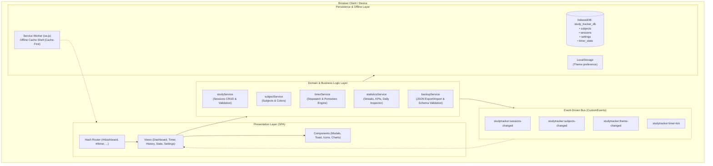
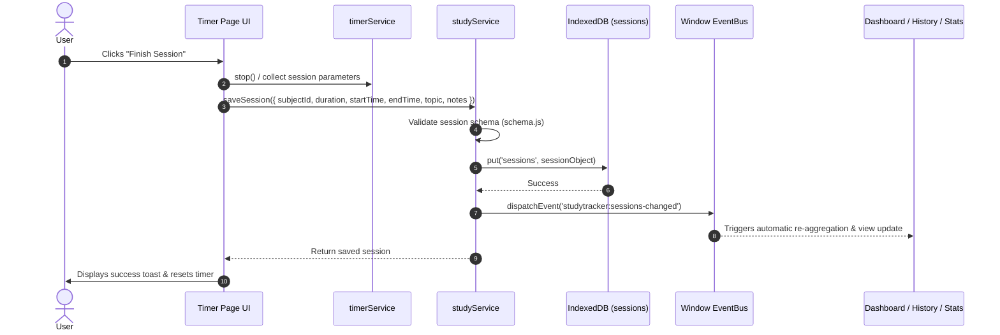
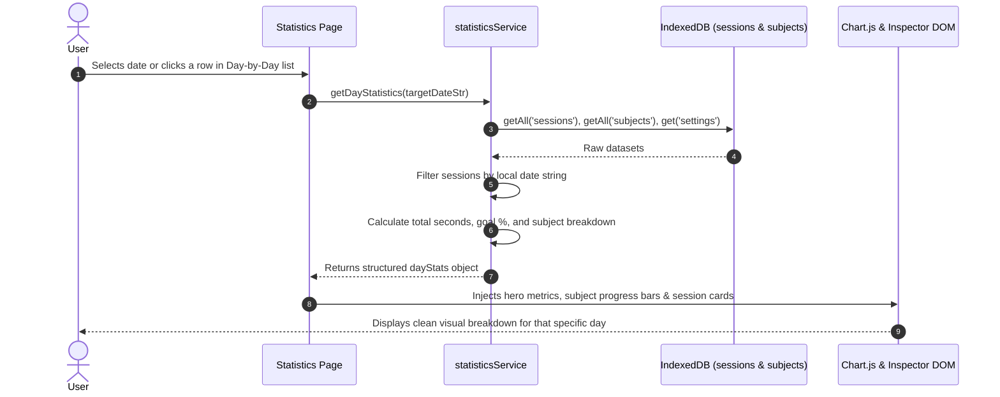

# StudyTracker — System Architecture & Technical Specification

> **A private, offline-first, zero-dependency personal study tracker web application built with vanilla JavaScript, modern CSS, IndexedDB, and Progressive Web App (PWA) standards.**

---

## 1. High-Level Architecture Overview

StudyTracker operates entirely on the client side without relying on external backends or cloud databases. All data is persisted locally in the browser using **IndexedDB**, guaranteeing privacy, zero latency, and seamless offline functionality.



---

## 2. Directory & Module Structure

```
d:\study tracker\
├── index.html               # Main SPA shell (Navigation, Header, Modals, Views Mount)
├── manifest.json            # PWA manifest metadata (app name, icons, standalone theme)
├── sw.js                    # Service Worker (Cache-First offline precaching and cache-busting)
├── run_tests.py             # Headless automated testing runner (Python + Chrome/Edge)
│
├── assets/
│   ├── icons/               # SVG and PWA application icons (192px, 512px)
│   └── lib/
│       └── chart.umd.min.js # Local offline Chart.js build (Zero CDN dependencies)
│
├── css/                     # Vanilla CSS Design System (Zero Frameworks, Theme-Aware)
│   ├── main.css             # Design tokens, variables (light/dark), reset, typography, header, mobile nav
│   ├── dashboard.css        # Hero metrics cards, goal progress bars, subject breakdown
│   ├── timer.css            # Analog-styled timer ring, digital readout, mode toggle, controls
│   ├── history.css          # Date-grouped study log, filter toolbar, session items
│   ├── statistics.css       # Visual analytics charts, Daily Study Inspector, Day-by-Day breakdown
│   └── settings.css         # Goal settings, Pomodoro durations, subjects management, backup/restore
│
└── js/
    ├── app.js               # Application Entrypoint, SPA Router, Theme Controller, Global Pill Sync
    │
    ├── db/                  # Persistence Layer
    │   ├── database.js      # Promisified IndexedDB wrapper (get, getAll, put, remove, transaction)
    │   ├── schema.js        # Object store schemas, field validators, default values
    │   └── migrations.js    # Database upgrade pipeline and schema versioning
    │
    ├── services/            # Domain Business Logic Layer
    │   ├── studyService.js       # Session CRUD, canonical seconds calculation, validation
    │   ├── subjectService.js     # Subject CRUD, archiving, color validation
    │   ├── timerService.js       # Timer state machine (Stopwatch & Pomodoro), persistence
    │   ├── statisticsService.js  # Streaks, 7/30-day KPIs, getDayStatistics, getDailyBreakdown
    │   └── backupService.js      # JSON export, JSON schema validator, conflict merge/overwrite
    │
    ├── components/          # Reusable UI Components
    │   ├── icons.js         # Offline Lucide SVG icon generator
    │   ├── toast.js         # Transient notification stack
    │   ├── modal.js         # Accessible modal dialog container with focus trap
    │   ├── subjectModal.js  # Subject creator/editor with interactive palette
    │   ├── sessionModal.js  # Manual session logger & editor
    │   └── importModal.js   # Backup file inspection and confirmation modal
    │
    ├── pages/               # Routed View Controllers
    │   ├── dashboard.js     # Overview view, streak counters, daily goal gauge, recent sessions
    │   ├── timer.js         # Active timer view, stopwatch & pomodoro controls, completion dialog
    │   ├── history.js       # Filterable study log grouped by date, search, edit, delete
    │   ├── statistics.js    # KPI cards, Daily Trend Chart, Doughnut, Daily Inspector, Day List
    │   └── settings.js      # App configuration, goals, subjects list, backup tools
    │
    └── utils/               # Pure Utilities
        ├── dateUtils.js     # Timezone-safe local calendar dates (YYYY-MM-DD), formatting
        ├── timeUtils.js     # Canonical seconds formatting (formatDuration, formatTimerDisplay)
        ├── formatUtils.js   # XSS sanitization (escapeHtml)
        └── idUtils.js       # Cryptographically secure UUID generation (crypto.randomUUID)
```

---

## 3. Core Architectural Subsystems

### 3.1. Client-Side Hash Router & Page Lifecycle
* **Mechanism:** Listens to `window.addEventListener('hashchange', ...)` and `DOMContentLoaded`.
* **Routes:** `#/dashboard`, `#/timer`, `#/history`, `#/statistics`, `#/settings`. Default route is `#/dashboard`.
* **View Lifecycle:**
  1. **Tear down (`cleanup`):** Calls the cleanup callback of the previous view to remove window event listeners, cancel intervals, and destroy Chart.js instances to prevent memory leaks.
  2. **Mount:** Injects the HTML template into `<main id="view-container">`.
  3. **Initialize (`init`):** Binds DOM events, loads data asynchronously from IndexedDB, and renders dynamic widgets.
  4. **Active Link Sync:** Updates `.active` states on desktop header links and mobile bottom navigation.

### 3.2. Local-First Database Layer (IndexedDB)
The application uses IndexedDB (`study_tracker_db`, Version `1`) wrapped in Promises:

| Object Store | Primary Key | Key Indexes | Purpose |
| :--- | :--- | :--- | :--- |
| `subjects` | `id` (string UUID) | `name`, `archived` | Subject categories with custom hex colors and archive states |
| `sessions` | `id` (string UUID) | `subjectId`, `date`, `startTime` | Completed study sessions with canonical durations and topics |
| `settings` | `key` (string) | — | User settings (daily goal, pomodoro durations, theme) |
| `timer_state` | `key` (string) | — | Active running timer state (persisted across tab closes/reloads) |

### 3.3. Timer State Machine & Background Persistence
* **Modes:** `STOPWATCH` (count up) and `POMODORO` (work/break intervals).
* **Resilience Against Refresh:** The timer does not rely solely on `setInterval` ticks. When running, it records the exact `startTimestamp` and `accumulatedSeconds` to the `timer_state` IndexedDB store. Upon reload or tab switch, elapsed time is computed via timestamp difference:
  $$\Delta t = \lfloor(t_{\text{now}} - t_{\text{start}})/1000\rfloor$$
* **Global Active Pill:** If a user navigates to History or Statistics while studying, a live pulsing badge in the top navigation bar displays the running session time.

### 3.4. Analytics & Daily Breakdown Engine
* **Timezone Consistency:** All date groupings rely on client-local calendar dates (`YYYY-MM-DD`) generated via `getLocalDateString()` to prevent UTC offset shifting.
* **Streak Calculation:** Evaluates consecutive unique study calendar dates backwards from today or yesterday (grace period). Cross-midnight sessions correctly credit both calendar dates.
* **Daily Inspector (`getDayStatistics`):** Fetches all sessions matching any chosen `YYYY-MM-DD` and computes:
  - Exact total seconds studied on that day
  - Daily goal completion percentage
  - Subject breakdown with duration and percentage
  - Detailed session timeline (time ranges, topics, notes)
* **Everyday List (`getDailyBreakdown`):** Generates day-by-day records for the chosen period (7 or 30 days) including zero-fill for rest days, allowing users to inspect any past day with a single click.
* **Visual Charts:** Renders via local Chart.js with dynamic dark/light theme palette adjustments.

### 3.5. Service Worker & Offline Caching Strategy
* **Precache Shell:** Precaches all HTML, CSS, JavaScript modules, Chart.js, and icons during the `install` event.
* **Cache-First with Background Revalidation:**
  - Serves cached assets instantly for lightning-fast loads and complete offline reliability.
  - Asynchronously revalidates against network to update local cache in the background.
* **Automatic Cache Busting:** When `CACHE_NAME` is bumped (e.g. `studytracker-v3`), `self.skipWaiting()` and `caches.delete(oldCache)` immediately replace stale scripts.

### 3.6. Event-Driven Reactivity
Instead of heavy reactive state libraries, the application uses native browser `CustomEvent` dispatchers on the `window` object:
- `studytracker:sessions-changed`: Fired when a session is saved, updated, deleted, or imported.
- `studytracker:subjects-changed`: Fired when subjects are created, edited, or archived.
- `studytracker:theme-changed`: Fired when switching between Light, Dark, or System mode.
- `studytracker:timer-tick`: Broadcasts running timer updates to the navigation pill and timer UI.

---

## 4. Key Data Flow Diagrams

### 4.1. Saving a Completed Study Session


### 4.2. Daily Study Inspector & Breakdown Query Flow


---

## 5. Security & Privacy Guarantees

1. **100% Local Storage:** No user data leaves the client device. No telemetry, analytics, or third-party tracking scripts.
2. **Zero External Dependencies:** Chart.js is bundled locally (`assets/lib/chart.umd.min.js`); icons are rendered as inline SVG vectors (`js/components/icons.js`).
3. **XSS Protection:** All user-supplied inputs (subject names, session topics, notes) are sanitized through `escapeHtml()` before DOM interpolation.
4. **Data Portability:** Full JSON backup and restore with strict schema verification and checksum validation.

---

## 6. Automated Testing Infrastructure

The project includes an integrated browser test runner (`run_tests.py`) that boots a local server and runs automated tests using headless Chrome/Edge across multiple test suites:

| Test Suite | File | Focus Area |
| :--- | :--- | :--- |
| **Phase 2** | `test_phase2.html` | IndexedDB operations, CRUD, error handling |
| **Phase 3** | `test_phase3.html` | Subject management, color validation, archiving |
| **Phase 4** | `test_phase4.html` | Session storage, validation, canonical seconds |
| **Phase 5** | `test_phase5.html` | Timer engine, stopwatch, pomodoro intervals |
| **Phase 6** | `test_phase6.html` | Dashboard calculations, streaks, daily goals |
| **Phase 7** | `test_phase7.html` | Statistics, 7/30-day zero-fill, Chart.js rendering |
| **Phase 8** | `test_phase8.html` | History filtering, search query, date grouping |
| **Phase 9** | `test_phase9.html` | Backup export, import strategies, schema validation |
| **Phase 10** | `test_phase10.html` | Full system end-to-end integration test (49/49 passed) |
| **Phase 11** | `test_phase11.html` | Daily Study Inspector & Day-by-Day breakdown (34/34 passed) |

Run all tests via terminal:
```powershell
python run_tests.py test_phase11.html
```
